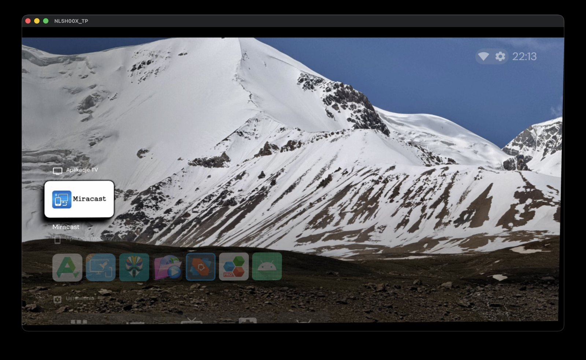

# NL5H00X Projector Toolkit

The NL5H00X is an Android 9 projector whose stock launcher cannot be changed from Settings. This toolkit backs up your device, installs Projectivy, and makes it the home screen without disabling the stock launcher.



## Requirements

- Install `adb` on your computer.
- Connect the projector to the same network as your computer, or use USB if your unit exposes device-mode ADB. Check the connection with `adb devices`.
- Confirm root works: `adb shell su 0 id` must print `uid=0`. The vendor `su` accepts `su 0 <cmd>`, not `su -c`.

## Quick start

```bash
git clone https://github.com/kolezka/NL5H00X.git
cd NL5H00X
adb connect <projector-ip>:5555    # if using network ADB
adb shell su 0 id                 # confirm uid=0
./nl5h00x
```

The guided menu shows backup, unlock, stock-launcher restore, detailed unlock state, app installation, root for apps, tools and hidden settings, refresh, and quit. Choose **1** to back up the device, then **2** to unlock it. The toolkit asks before it changes anything.

Unlock follows these steps:

1. Check that this is an NL5H00X and that the device backup is verified.
2. Enable Developer options and allow installation from unknown sources.
3. Install Projectivy if it is not already present. If normal installation is blocked, copy it to `/system/app`, check its hash, and restart the projector once. The toolkit continues after the restart.
4. Back up `wtprovision`'s launcher cache and record its hash.
5. Write Projectivy to that cache as root, then restart `wtprovision`.
6. Check the focused HOME window to confirm Projectivy is on screen.

Leave the projector connected during a fallback restart. After unlock, HOME opens Projectivy with the stock launcher still available. `./nl5h00x status` reports the backup, unlock and root state without changing them.

## What else it can do

- `./nl5h00x status`: show the backup, unlock and root state.
- `./nl5h00x backup`: make a device backup before any change.
- `./nl5h00x unlock [--yes]`: run the checked launcher unlock; `--yes` skips the prompt.
- `./nl5h00x revert [--yes]`: put the stock launcher back through the cache; `--yes` skips the prompt.
- `./nl5h00x install <apk> [flags]`: install an app normally, with a checked `/system/app` fallback if installs are gated. See [Installing apps](docs/INSTALL_LOCKED.md).
- `./nl5h00x root <command> [args]`: manage app root with `status`, `install`, `allow PKG`, `deny PKG` or `revert`. See [Root for apps](root/README.md).
- `./nl5h00x tools`: open tools and hidden settings.
- `./nl5h00x repair`: diagnose a launcher boot failure and print serial-console steps when adb is unavailable.
- `./nl5h00x install-gate off|on|status`: inspect or change the vendor install gate. `off` changes `/system/build.prop` for every app on the projector and needs `adb reboot` to take effect; unlock never runs it. See [the gate and its revert](docs/INSTALL_LOCKED.md).
- `./nl5h00x help`: show all commands.

For one release, `./scripts/PROJECTOR.sh` still opens the guided menu. Use `./nl5h00x` for new work.

## How the unlock works

This firmware adds `SETUP_WIZARD` to the HOME intent, so `com.newlink.wtprovision/.MainActivity` wins that intent. `wtprovision` then starts the component stored in its own launcher cache, not Android's home preference. The unlock puts Projectivy in that cache after making a hash-checked copy of the old value. It never disables `wtprovision` or the stock launcher, because disabling the former can prevent boot from completing. It uses `kill -9` to restart `wtprovision` so the service reads the new cache without a projector restart. A launcher installed in `/data/app` may take about ten seconds to resolve at boot, during which `wtprovision` retries; this is accepted, not the disabled-component deadlock. Keep Projectivy installed while the cache names it, or revert first. See [Boot deadlock](docs/BOOT_DEADLOCK.md) for the failure and recovery path.

## When something goes wrong

- If the projector does not boot, use [Boot deadlock](docs/BOOT_DEADLOCK.md) for a disabled `wtprovision` and [Will not boot](docs/UNBOOTABLE.md) for other causes.
- If you need the stock recovery console, read [Recovery](docs/RECOVERY.md) before writing a bootloader message or rebooting.
- If you want the stock launcher back, run `./nl5h00x revert`; the generated `RESTORE.sh` is in your backup directory for broader restores, but a hardware restore is still on HOLD because it has not been tested on this unit.

## Documentation

| Document | What it covers |
|---|---|
| [Boot branding](docs/BOOT_BRANDING.md) | The U-Boot logo, boot video service and boot animation. |
| [Boot deadlock](docs/BOOT_DEADLOCK.md) | Why disabling `wtprovision` stalls boot and how to recover over UART. |
| [Developer options](docs/DEV_OPTIONS_CRASH.md) | Why the settings screen crashes and how the AOSP test key affects patching. |
| [Device audit](docs/DEVICE_AUDIT_2026-10-24.md) | Root, partition and rescue evidence from the owner's modified unit. |
| [Installing apps](docs/INSTALL_LOCKED.md) | The vendor install gate, its `build.prop` fix and the older `/system/app` route. |
| [Docs index](docs/README.md) | An index to the project's technical documentation. |
| [Recovery](docs/RECOVERY.md) | Booting the stock recovery through `misc` and using its serial console. |
| [Security and recovery](docs/SECURITY_ANALYSIS.md) | Observed access and the limits of recovery claims. |
| [Technical notes](docs/TECHNICAL_NOTES.md) | Device details, ADB commands and partition layout. |
| [Will not boot](docs/UNBOOTABLE.md) | UART checks and first steps after a failed modification. |
| [Vendor apps audit](docs/VENDOR_APPS_2026-10-26.md) | Read-only inventory and risks of vendor system apps. |
| [Vendor telemetry](docs/VENDOR_TELEMETRY.md) | Reporting to the vendor, OTA limits and network blocking. |
| [System documentation](docs/system/README.md) | Source-pinned toolkit contracts and test-harness navigation. |
| [Root for apps](root/README.md) | The app-root socket daemon, allow-list and hybrid `su`. |
| [Recovery tools](tools/recovery/README.md) | Host tools for the BCB and serial recovery console. |

## Development

Run `PT_TEST_BASH=/bin/bash bash tests/local/run.sh` against the fake device instead of risking the projector. The scripts must also work with macOS `/bin/bash` 3.2, not just a newer Bash on your PATH. See the [test harness](docs/system/test-harness/) for fixture and runner details.

## Contributing

See [CONTRIBUTING.md](CONTRIBUTING.md).

## License

[MIT License](LICENSE).
